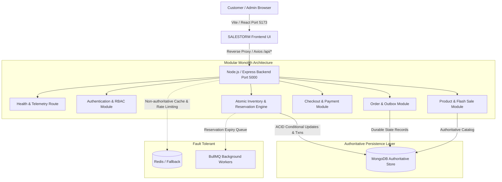

# SALESTORM — Architecture & Phase 1 Foundation

## 1. System Overview

**SALESTORM** is an AI-assisted, high-scale flash sale management system engineered for extreme concurrency scenarios (e.g. 10,000 simultaneous customers competing for 100 stock units) without inventory overselling, race conditions, or silent order loss.

---

## 2. Phase 1 Core Architectural Guarantees

1. **MongoDB is the Authoritative Store of Truth:**
   - Inventory, reservations, idempotency keys, payments, and orders are stored in MongoDB.
   - Redis is strictly used for non-authoritative caching and background queue coordination.
   - If Redis becomes unavailable, MongoDB remains uncompromised and the application continues to run in resilient fallback mode.

2. **Atomic Invariant Maintenance:**
   - Inventory invariants are enforced at the database level:
     $$\text{totalQuantity} = \text{availableQuantity} + \text{reservedQuantity} + \text{soldQuantity}$$
   - Quantities can never drop below zero.

3. **Liveness & Readiness Probing:**
   - `/api/health`: Provides liveness verification, database connectivity details, and Redis status.
   - `/api/ready`: Returns HTTP 200 only when the authoritative MongoDB connection is ready (`readyState === 1`), returning HTTP 503 if disconnected.
   - `/api/metrics`: Exposes memory usage (RSS, heap allocated, heap used) and process uptime.

---

## 3. Technology Stack Alignment

| Tier | Technology | Purpose |
| :--- | :--- | :--- |
| **Frontend** | React 18, Vite, Tailwind CSS, Lucide React, Recharts | Fast, responsive UI with telemetry, dashboard, and customer flows |
| **Backend** | Node.js (v24), Express.js (v4), ES Modules | Modular monolith REST APIs with Zod validation |
| **Database** | MongoDB 8.0, Mongoose ODM 8.12 | Authoritative persistence, conditional updates, replica-set support |
| **Cache/Queue**| Redis 7, BullMQ (with fallback handling) | Background expiry jobs, outbox retries, rate-limiting |
| **Testing** | Node.js Native Test Runner, Supertest | Fast automated unit, integration, and concurrency verification |

---

## 4. Phase 1 Deliverables Summary

- [x] Project workspace inspected and verified.
- [x] Backend initialized with Express, Mongoose, and ES modules.
- [x] MongoDB connectivity tested and verified against local MongoDB 8.0.
- [x] Redis connection wrapper created with automatic fallback mode.
- [x] `/api/health`, `/api/ready`, and `/api/metrics` implemented and passing automated tests.
- [x] Frontend scaffolded with React, Vite, Tailwind CSS, and telemetry dashboard.
- [x] Root `.env.example`, `docker-compose.yml`, and `.gitignore` configured.
